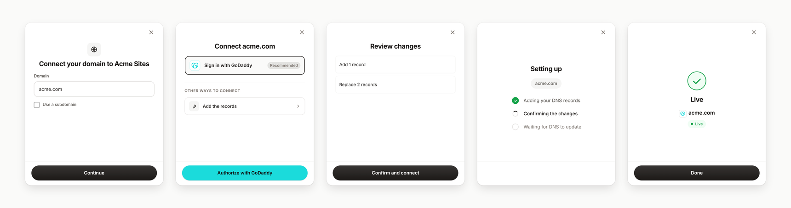

<p align="center"><picture><source media="(prefers-color-scheme: dark)" srcset=".github/media/customdomain-mark-dark.png"></picture></p>
<h1 align="center">CustomDomain CLI</h1>
<p align="center"><b>Sign in from your terminal, give your project its API key, and check what stands between a domain and your app.</b></p>
<p align="center"><a href="https://www.npmjs.com/package/@customdomain/cli"></a> <a href="https://github.com/CUSTOM-DOMAIN-APP/homebrew-tap"></a> <a href="https://github.com/CUSTOM-DOMAIN-APP/customdomain-cli/releases"></a> <a href="https://docs.customdomain.ai/docs"></a> <a href="https://www.producthunt.com/products/custom-domain"></a></p>
<p align="center"><picture><source media="(prefers-color-scheme: dark)" srcset=".github/media/widget-flow-dark.png"></picture></p>

## Install

|  | Install |
|---|---|
| <picture><source media="(prefers-color-scheme: dark)" srcset="https://cdn.simpleicons.org/npm/e7e5e4"></picture> | `npm install -g @customdomain/cli` |
| <picture><source media="(prefers-color-scheme: dark)" srcset="https://cdn.simpleicons.org/homebrew/e7e5e4"></picture> | `brew install custom-domain-app/tap/customdomain` |
| <picture><source media="(prefers-color-scheme: dark)" srcset="https://cdn.simpleicons.org/github/e7e5e4"></picture> | Binaries for macOS, Linux and Windows on the [releases page](https://github.com/CUSTOM-DOMAIN-APP/customdomain-cli/releases) |

Or run it once without installing: `npx @customdomain/cli init`.

## Use

```text
customdomain init [--app app_123] [--env-file .env.local]    create an API key and save it to the project's env file
customdomain login                                           sign in from this terminal
customdomain logout                                          end this terminal's access
customdomain whoami                                          who this terminal acts as
customdomain domains                                         list your connected domains
customdomain doctor <domain>                                 where a domain's DNS lives and what is in the way
customdomain version                                         print the version
```

`init` is the quickest start. It opens a page where you approve the sign-in, creates an API key for your application
and writes `CUSTOMDOMAIN_API_KEY` and `CUSTOMDOMAIN_APPLICATION_ID` to your env file, so the key never has to be
copied or pasted. It works the same when a coding agent runs it for you.

Docs: [docs.customdomain.ai](https://docs.customdomain.ai).

## License

Apache-2.0. This repository is published from the CustomDomain™ source; open issues here.
